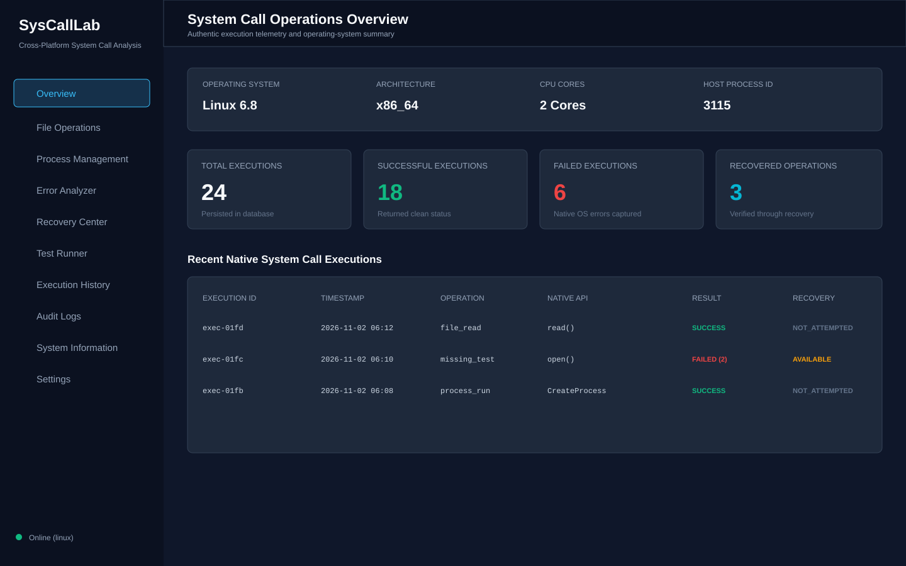

# SysCallLab

SysCallLab is a local, offline system-call laboratory for observing how file operations, process creation, native error codes, recovery workflows, and test assertions behave on the operating system where it is running. It combines a native C17 backend with a dependency-free browser dashboard and SQLite persistence.

The project is intended for systems programming education, operating-system debugging, portability work, QA investigations, and controlled demonstrations of failure handling. It does not replace a production tracing or security tool. Operations are deliberately small, explicit, and recorded so that a developer can reproduce a result and inspect the native return code behind it.

## What the application does in real life

When an application opens a file, writes data, starts a child process, or receives an operating-system failure, the useful information is usually below the level of the application UI. SysCallLab provides a safe place to exercise those boundaries and see the result as structured telemetry.

Typical real-world uses include:

1. **Learning operating-system APIs.** A developer can compare the same logical operation on Linux, macOS, and Windows and see the platform-specific API name, native error number, error identifier, and human-readable explanation.
2. **Debugging file failures.** The file-operation lab can reproduce missing-file, invalid-descriptor, read-only, open, read, and write scenarios without requiring a separate debugger.
3. **Testing process supervision.** The process lab runs controlled helper programs, captures standard output and standard error, records exit status, and enforces a timeout.
4. **Designing recovery behavior.** The error analyzer classifies failures and proposes a recovery action. The recovery center requires explicit confirmation before attempting a supported remediation.
5. **Building regression evidence.** Every execution is stored in SQLite. The history and audit views make it possible to review what happened later, while CSV export makes the data usable in another tool.
6. **Validating portability.** The same dashboard and API surface are backed by platform-specific implementations for Linux, macOS, and Windows.
7. **Teaching incident response.** A team can intentionally create a controlled failure, inspect the native evidence, document the cause, and verify whether recovery changed the result.

SysCallLab is local by design. The server binds to `127.0.0.1`, the dashboard is served by the native executable, and no external service is required.

## Main capabilities

### Overview

The overview page combines:

- Operating-system name and version.
- CPU architecture and core count.
- Host process ID.
- Total, successful, failed, and recovered execution counts.
- The five most recent native system-call executions.

### File Operations

The file page sends an operation to the native backend and records the result. Supported operations include:

- Open with read, write, or read/write mode.
- Read a bounded number of bytes.
- Write controlled content.
- Missing-file test.
- Invalid-descriptor test.
- Read-only write test restricted to the application temporary directory.

Destructive or write operations require an explicit confirmation flag. The backend validates the operation, mode, content, and test path before it reaches the platform layer.

### Process Management

The process page starts a controlled executable through the platform abstraction. It records:

- Executable path and arguments.
- Process identifier.
- Exit code.
- Standard output and standard error.
- Whether the process exited before the timeout.
- The native process-creation error if creation failed.

The repository includes `test_child` and `test_executable` helper programs for repeatable demonstrations.

### Error Analyzer

The analyzer reloads an execution from SQLite and enriches it with the current platform error-mapping logic. Each result includes:

- Native return value.
- Native error number.
- Platform error identifier.
- Error category.
- Description.
- Possible cause.
- Suggested recovery.

### Recovery Center

Recovery is explicit and user-confirmed. The page can run a supported remediation against a selected execution and then records whether the recovery succeeded, failed, or was not applicable.

### Test Runner

The test runner executes the built-in system-call assertion suite. Tests cover expected successes and expected failures and return a per-test result with category, operation, expected outcome, actual outcome, native error code, and details.

### History and Audit Logs

History is persisted in SQLite and includes the latest 50 executions. Audit logs use the same persistent execution data and provide a CSV export endpoint for analysis or archival.

### System Information and Settings

The system page reports host, architecture, compiler, memory, process, and thread details. The settings page shows the bound address, port, database path, temporary directory, and logging mode.

## Screenshots

The dashboard is a dark, responsive single-page application. The following preview is a repository-local image asset showing the documented overview layout:



To capture a fresh browser screenshot after starting SysCallLab, use a Chromium/Playwright installation on a machine with browser runtime libraries:

```bash
npx playwright screenshot --device="Desktop Chrome" --full-page \
  http://127.0.0.1:8080 docs/screenshots/overview.png
```

The checked-in SVG preview is intentionally independent of runtime data so the README remains useful in source archives. A PNG captured from the running application may be added beside it when release assets are generated.

## Architecture

```text
Browser
  |
  | HTTP on 127.0.0.1:8080
  v
Native C HTTP server
  |
  +-- API route layer
  |     +-- file execution
  |     +-- process execution
  |     +-- error analysis
  |     +-- recovery
  |     +-- tests
  |     +-- history, logs, settings
  |
  +-- Platform abstraction
  |     +-- Linux
  |     +-- macOS
  |     +-- Windows
  |
  +-- SQLite persistence
  +-- Structured application log
```

Important source areas:

- `backend/src/main.c`: application startup and shutdown.
- `backend/src/core/`: configuration, execution, analysis, recovery, and tests.
- `backend/src/server/`: HTTP server, routes, JSON handling, and static-file serving.
- `backend/src/platform/`: operating-system-specific implementations.
- `backend/src/storage/`: SQLite database and logging.
- `frontend/`: static HTML, CSS, and JavaScript dashboard.
- `helper/`: controlled child-process test programs.

## API reference

The server exposes these endpoints:

| Method | Endpoint | Purpose |
| --- | --- | --- |
| `GET` | `/api/health` | Backend status, version, and platform |
| `GET` | `/api/system/info` | Host and process information |
| `GET` | `/api/system/compatibility` | Platform feature support |
| `GET` | `/api/statistics` | Execution counters |
| `POST` | `/api/file/execute` | Execute a validated file operation |
| `POST` | `/api/process/execute` | Execute a controlled process operation |
| `POST` | `/api/error/analyze` | Enrich a stored execution |
| `POST` | `/api/recovery/execute` | Run confirmed recovery |
| `POST` | `/api/tests/run` | Run the system-call test suite |
| `GET` | `/api/history` | Read recent executions |
| `GET` | `/api/logs` | Read audit execution records |
| `GET` | `/api/logs/export` | Download CSV audit data |
| `GET` | `/api/settings` | Read runtime configuration |

Example health check:

```bash
curl http://127.0.0.1:8080/api/health
```

## Requirements

For Linux or macOS development:

- CMake 3.10 or newer.
- A C17-capable compiler.
- POSIX sockets and pthread support.

For Windows:

- Windows 10 or newer.
- CMake 3.10 or newer.
- Visual Studio with the Desktop development with C++ workload, or MinGW-w64.
- PowerShell 5.1 or newer.

SQLite and cJSON are included in `backend/third_party`, so no package manager or network connection is required to build the application.

## Build on Linux or macOS

From the repository root:

```bash
cmake -S . -B build
cmake --build build --parallel
ctest --test-dir build --output-on-failure
```

The main executable is written to:

```text
build/bin/SysCallLab
```

Run it from the repository root so the default relative paths resolve:

```bash
./build/bin/SysCallLab
```

Open [http://127.0.0.1:8080](http://127.0.0.1:8080) in a browser. Use `Ctrl+C` to stop the server. A different port can be supplied as the first argument:

```bash
./build/bin/SysCallLab 9090
```

If running from the build directory, use the path-aware layout expected by the configuration code:

```bash
cd build
./bin/SysCallLab
```

## Build a portable Windows package

The repository includes [`scripts/build-windows.ps1`](scripts/build-windows.ps1). On a Windows development machine, run PowerShell from the repository root:

```powershell
Set-ExecutionPolicy -Scope Process Bypass
.\scripts\build-windows.ps1
```

The script:

1. Configures CMake in `build-windows`.
2. Builds the native executable and both helper executables.
3. Creates `release\SysCallLab`.
4. Copies `SysCallLab.exe`, `test_child.exe`, `test_executable.exe`, and the frontend.
5. Creates a writable `data` directory.
6. Writes `Start-SysCallLab.bat`, which launches the server and opens the dashboard.

The resulting portable package is:

```text
release\SysCallLab\
  SysCallLab.exe
  Start-SysCallLab.bat
  README.txt
  bin\
    test_child.exe
    test_executable.exe
  frontend\
  data\
```

Double-click `Start-SysCallLab.bat` for the easiest Windows experience. If you need the executable itself, double-click `SysCallLab.exe` or run `SysCallLab.exe 8080` from that package directory, then open `http://127.0.0.1:8080`.

The executable is a native console server, not a GUI shell. The batch launcher is included so the packaged application can be started by double-clicking one file and can open the browser automatically. Creating a single-window desktop shell would require adding and distributing a separate WebView runtime, which is intentionally not required by SysCallLab.

## Runtime data and safety

Runtime files are created below `data/`:

- `data/syscalllab.db`: SQLite execution history.
- `data/syscalllab.log`: application log.
- `data/syscall_temp/`: controlled temporary test files and CSV exports.

The server binds only to loopback by default. It should not be exposed to an untrusted network without adding authentication, authorization, request limits, and a hardened HTTP implementation. Do not point write tests at valuable files. Use the application temporary directory for demonstrations.

## Testing

Run the CTest suite:

```bash
ctest --test-dir build --output-on-failure
```

The unit test executable is also available directly:

```bash
./build/bin/test_backend_unit
```

For a manual smoke test:

```bash
./build/bin/SysCallLab 8080
curl -fsS http://127.0.0.1:8080/api/health
curl -fsS http://127.0.0.1:8080/api/system/info
```

## Troubleshooting

### The dashboard says “Server Disconnected”

Confirm that `SysCallLab` is still running and that the browser URL uses the same port passed to the executable. Check the server console for startup errors.

### The database cannot be opened

Start the executable from the package or repository root, not from an unrelated working directory. Ensure the process has write access to `data/`.

### Helper process tests fail

Verify that `test_child` and `test_executable` exist in `build/bin` for a development build or in the package `bin` directory for Windows. The helper directory is selected from the current layout.

### Port 8080 is already in use

Pass another port:

```bash
./build/bin/SysCallLab 9090
```

Then open `http://127.0.0.1:9090`.

## Project status and release checklist

Before distributing a build:

1. Build on the target operating system.
2. Run `ctest --test-dir build --output-on-failure`.
3. Start the executable from the intended package directory.
4. Confirm `/api/health`, `/api/system/info`, and `/api/statistics`.
5. Run one successful file operation and one expected failure.
6. Run a helper process test and verify captured output.
7. Run the test runner.
8. Confirm history is persisted after restarting the server.
9. Confirm CSV export opens successfully.
10. Capture a fresh browser screenshot from the release package.

## License

See [LICENSE](LICENSE).
